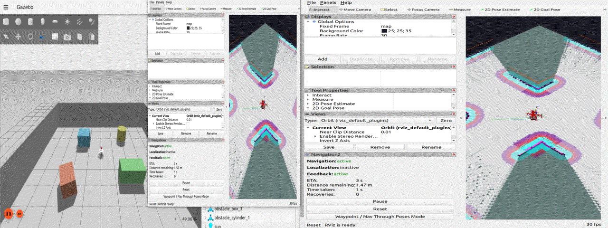
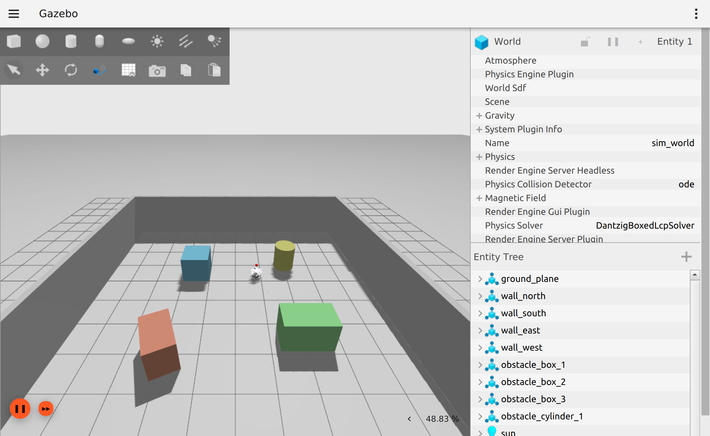
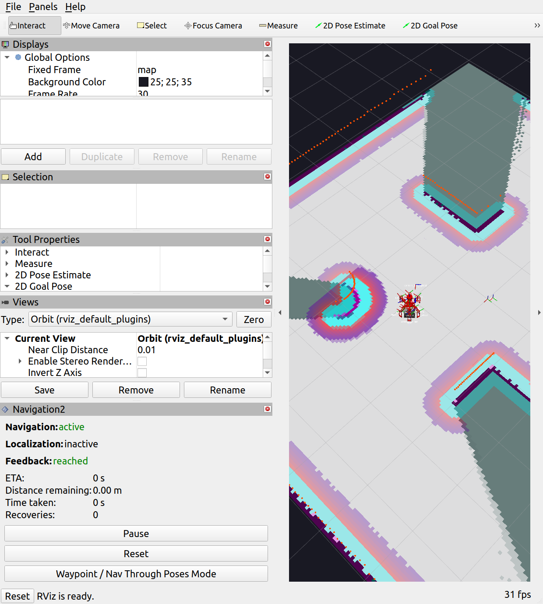
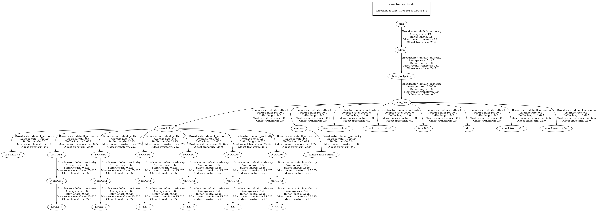
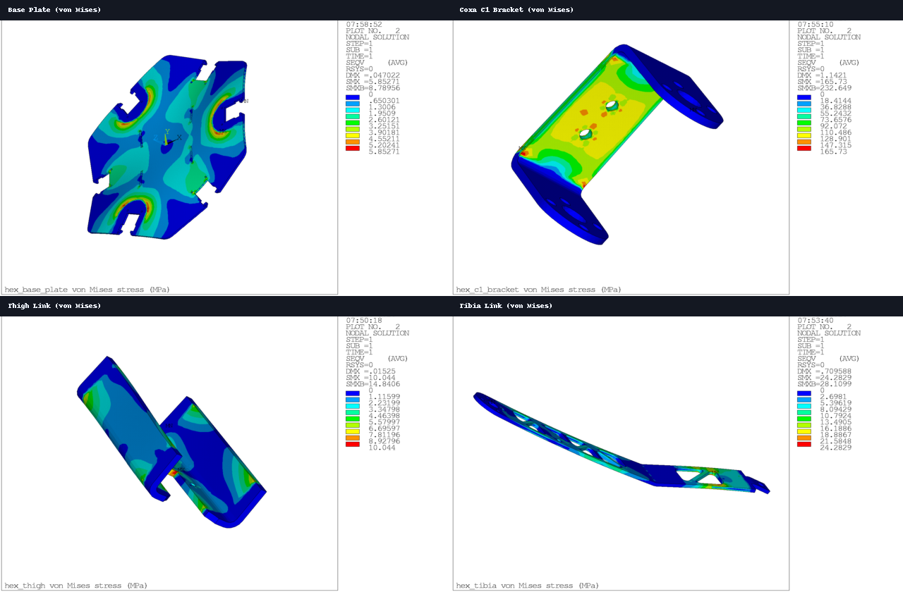
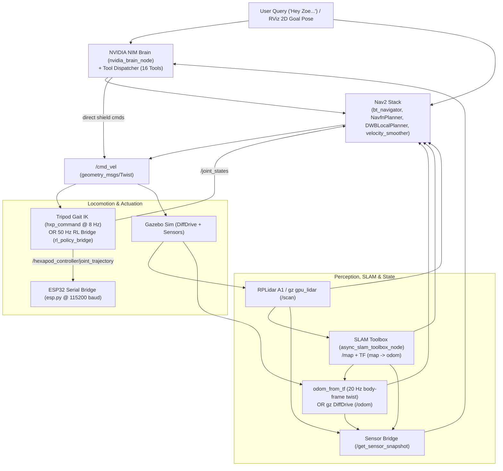

# Z.O.E. Hexapod – ROS 2 Autonomous Navigation, SLAM & AI Stack

### 18-DOF Hexapod Navigation, LiDAR SLAM, Gazebo Sim, Multimodal LLM Brain & RL Policy Bridge (ROS 2 Humble / Jazzy)

[](https://github.com/Rithwik-Ravi/Z.O.E.-Hexapod-ROS2-Navigation/actions/workflows/ci.yml)
[](https://docs.ros.org/)
[](https://gazebosim.org/)
[](#navigation--slam-architecture)
[](#4-autonomous-ai-brain-zoe)
[](src/rover/test/)
[](LICENSE)

**Z.O.E.** (Zone Operational Entity) Hexapod ROS 2 Navigation is the full-stack autonomy, mapping, simulation, and hardware-bridge repository for the 18-degree-of-freedom (18-DOF) Z.O.E. hexapod robot. It integrates **ROS 2 (Humble & Jazzy)**, **Gazebo Sim (Ignition Fortress & Harmonic)**, **SLAM Toolbox**, **Nav2**, an **ESP32 serial servo bridge**, an **NVIDIA NIM** natural-language/vision tool-calling brain, and a 50 Hz **RL policy deployment bridge** aligned with [`Rithwik-Ravi/Z.O.E.-Hexapod-Isaac-Lab-Reinforced-Learning`](https://github.com/Rithwik-Ravi/Z.O.E.-Hexapod-Isaac-Lab-Reinforced-Learning).

---

> [!NOTE]
> **Active Runtime Environments**:
> - **Simulation (`sim_navigation.launch.py`, `autonomous.launch.py`)**: Cross-distro compatible with **ROS 2 Humble (Ignition Gazebo 6)** and **ROS 2 Jazzy (Gazebo Harmonic)** via [`sim_compat.py`](src/rover/rover/sim_compat.py).
> - **Physical Hardware (`real_navigation.launch.py`, `real_autonomous.launch.py`)**: Drives RPLidar A1 (`/scan` @ 115200 baud) + ESP32 18-servo controller (`/hexapod_controller/joint_trajectory` @ 115200 baud) + `odom_from_tf`.
> - **RL Policy Bridge (`rl_policy_bridge`)**: Drop-in 50 Hz inference node implementing the 63-D deployable Actor observation contract from the Z.O.E. Isaac Lab RL repository (see [RL Policy Integration Guide](docs/RL_POLICY_INTEGRATION.md)).

---

## Live Simulation & Verification Showcase

<p align="center">
  
  <br/>
  <em>Live ROS 2 Humble + Ignition Gazebo 6 + SLAM Toolbox + Nav2 run executing <code>NavigateToPose (x=1.4, y=-1.0)</code> (status: <code>SUCCEEDED</code>, 0 recoveries).</em>
</p>

| Ignition Gazebo World (`sim_world.sdf`) | RViz2 SLAM Map, Costmaps & Nav2 Goal |
| :---: | :---: |
|  |  |
| **Live TF2 Transform Tree (`view_frames`)** | **Ansys MAPDL Structural FEA (von Mises Stress)** |
|  |  |

---

## Contents

- [Key Capabilities](#key-capabilities)
- [Hardware & Simulation Specifications](#hardware--simulation-specifications)
- [System Architecture](#system-architecture)
- [ROS 2 Interface Reference](#ros-2-interface-reference)
- [Prerequisites & Installation](#prerequisites--installation)
- [Quick Start](#quick-start)
  - [1. Simulation Only (Gazebo + RViz2)](#1-simulation-only-gazebo--rviz2)
  - [2. Autonomous SLAM & Nav2 Navigation (Sim)](#2-autonomous-slam--nav2-navigation-sim)
  - [3. Real Hardware Navigation](#3-real-hardware-navigation)
  - [4. Autonomous AI Brain ("Zoe")](#4-autonomous-ai-brain-zoe)
  - [5. 50 Hz RL Policy Bridge](#5-50-hz-rl-policy-bridge)
- [Empirical Verification & Performance](#empirical-verification--performance)
- [Testing & CI](#testing--ci)
- [Repository Structure](#repository-structure)
- [Known Limitations & Engineering Notes](#known-limitations--engineering-notes)
- [License & Acknowledgments](#license--acknowledgments)

---

## Key Capabilities

| Capability | Technical Implementation |
|---|---|
| **Dual ROS 2 Distro Support** | Automatic runtime adaptation ([`sim_compat.py`](src/rover/rover/sim_compat.py)) translating Gazebo plugin tags, `ros_gz_bridge` message namespaces (`ignition.msgs` vs `gz.msgs`), and Nav2 plugin IDs across **Humble** and **Jazzy**. |
| **18-DOF Tripod Gait & Analytical IK** | [`hxp_command.py`](src/rover/rover/hxp_command.py) discretizes `/cmd_vel` (`f/b/l/r/s`) into an alternating tripod gait (`[1,3,5]` vs `[2,4,6]`) with 3-DOF analytical leg IK (`35 / 75 / 160 mm`) at **8 Hz**, plus `0.6 s` watchdog timeout and graceful stance reset on `SIGINT`. |
| **SLAM & Encoderless Odometry** | `slam_toolbox` (`async_slam_toolbox_node`) builds 5 cm 2D occupancy grids from `/scan`; on hardware without encoders, [`odom_from_tf.py`](src/rover/rover/odom_from_tf.py) derives `/odom` at **20 Hz** and rotates linear velocity into the `base_footprint` body frame (REP-103). |
| **Field-Tuned Nav2 Stack** | `NavfnPlanner` global planner + `DWBLocalPlanner` (`RotateToGoal` / `GoalAlign` disabled for hexapod efficiency) + `velocity_smoother` (`OPEN_LOOP`), with separate sim (`nav2_params.yaml`) and hardware-tuned (`nav2_real_params.yaml`) profiles. |
| **Autonomous AI Brain ("Zoe")** | [`nvidia_brain_node.py`](src/rover/rover/nvidia_brain_node.py) + [`sensor_bridge_node.py`](src/rover/rover/sensor_bridge_node.py) + [`tool_dispatcher_node.py`](src/rover/rover/tool_dispatcher_node.py) expose 16 ROS-backed tools (Nav2 goals, OpenCV frontier exploration, HSV object search, dynamic LiDAR obstacle shield, dance/rotate) via NVIDIA NIM OpenAI-compatible function calling. |
| **Isaac Lab RL Deployment Bridge** | [`rl_policy_bridge.py`](src/rover/rover/rl_policy_bridge.py) implements the 63-D Actor observation vector, $0.50\text{ rad}$ action scaling, and $6.0^\circ/\text{step}$ slew-rate clamp at **50 Hz** for NumPy MLP policy exports (`policy_mlp.npz`). |
| **CAD & Ansys FEA Artifacts** | Full STEP assembly ([`CAD/Hexapod.step`](CAD/Hexapod.step)) and Ansys MAPDL 2026 R1 Student structural convergence & stress reports under [`FEA/`](FEA/). |

---

## Hardware & Simulation Specifications

| Subsystem | Physical Hardware Configuration | Gazebo Simulation Representation |
|---|---|---|
| **Kinematic Topology** | 6 legs × 3 revolute joints (`NCCUP{1..6}`, `NTHIGH{1..6}`, `NFOOT{1..6}`), `[-1.5, +1.5]` rad limits | [`hexa.urdf`](src/rover/urdf/hexa.urdf) (30 links, 29 joints; hexapod body mounted above diff-drive base for sim navigation) |
| **Footprint & Geometry** | Hexagonal foot span: `0.54 m` (L) × `0.48 m` (W); Nav2 inflation radius `0.48 m` | 6-vertex polygon `[[0.27,0],[0.14,0.24],[-0.14,0.24],[-0.27,0],[-0.14,-0.24],[0.14,-0.24]]` |
| **LiDAR** | Slamtec **RPLidar A1** (`rplidar_ros` v2.1.4, `115200` baud, `Sensitivity` mode, `0.12–12.0 m`, frame `lidar`) | `gpu_lidar` (`10 Hz`, 360 samples, `±π` rad, `0.12–12.0 m`) bridged to `/scan` |
| **Actuator Interface** | **ESP32** USB serial bridge ([`esp.py`](src/rover/rover/esp.py)) at `115200` baud; calibrated `j1_neutral` + Leg 3 inversion; `[0, 180]°` clamp | `gz DiffDrive` on `/cmd_vel` + `hxp_command` publishing `/joint_states` |
| **Real-Robot Nav2 Limits** | `max_vel_x = 0.12 m/s`, `max_vel_theta = 0.5 rad/s`, `controller_frequency = 5.0 Hz`, `xy_goal_tolerance = 0.30 m` | `max_vel_x = 0.5 m/s`, `max_vel_theta = 1.0 rad/s`, `controller_frequency = 20.0 Hz`, `xy_goal_tolerance = 0.25 m` |
| **RL Policy Target Hardware** | Waveshare **ST3215** 12V 1 Mbaud bus servos + 50 Hz IMU (see [RL Integration Guide](docs/RL_POLICY_INTEGRATION.md)) | `rl_policy_bridge` (`50 Hz`, 63-D obs, `6.0°/step` slew limiter) |

---

## System Architecture



**TF2 Frame Tree:**
```text
map (slam_toolbox)
 └── odom (static identity on real HW | gz DiffDrive in sim)
      └── base_footprint
           └── base_link
                ├── lidar
                ├── imu_link
                ├── camera ──▶ camera_link_optical
                └── base_link-v1 (hexapod chassis)
                     ├── top-plate-v2
                     └── NCCUP{1..6} ──▶ NTHIGH{1..6} ──▶ NFOOT{1..6}
```

---

## ROS 2 Interface Reference

### Key Topics

| Topic | Message Type | Producer | Consumer(s) | Rate / QoS |
|---|---|---|---|---|
| `/cmd_vel` | `geometry_msgs/msg/Twist` | `velocity_smoother`, `tool_dispatcher`, `teleop` | `hxp_cmd`, `rl_policy_bridge`, Gazebo `DiffDrive` | 10–20 Hz, Reliable |
| `/hexapod_controller/joint_trajectory` | `trajectory_msgs/msg/JointTrajectory` | `hxp_cmd`, `rl_policy_bridge` | `esp_bdg` (real ESP32 bridge) | 8 Hz / 50 Hz, Reliable |
| `/joint_states` | `sensor_msgs/msg/JointState` | `hxp_cmd`, `joint_state_publisher_gui` | `robot_state_publisher`, `rl_policy_bridge`, `cal_servo` | 8 Hz / 50 Hz, Reliable |
| `/scan` | `sensor_msgs/msg/LaserScan` | `rplidar_node`, `ros_gz_bridge` | `slam_toolbox`, Nav2 costmaps, `sensor_bridge`, `tool_dispatcher` | ~6.7–10 Hz, KeepLast(10) |
| `/odom` | `nav_msgs/msg/Odometry` | `odom_from_tf` (real), `ros_gz_bridge` (sim) | `bt_navigator`, `velocity_smoother`, `sensor_bridge` | 20 Hz / 50 Hz |
| `/map` | `nav_msgs/msg/OccupancyGrid` | `slam_toolbox` | `global_costmap`, `sensor_bridge`, `tool_dispatcher`, `rviz2` | ~0.7–1 Hz, `TRANSIENT_LOCAL` |
| `/imu/data` | `sensor_msgs/msg/Imu` | `ros_gz_bridge` (sim) | `rl_policy_bridge`, `imu_stabilizer` | 100 Hz (sim) |
| `/camera/camera/image_raw` | `sensor_msgs/msg/Image` | `ros_gz_bridge` (sim) | `sensor_bridge`, `object_detector`, `box_tracker` | 30 Hz (sim) |
| `/brain/query` & `/brain/response` | `std_msgs/msg/String` | `voice_bridge`, CLI / `nvidia_brain` | `nvidia_brain` / `voice_bridge` | Event-driven |

### Services & Actions

| Interface | Type | Provider | Purpose |
|---|---|---|---|
| `/navigate_to_pose` | `nav2_msgs/action/NavigateToPose` | `bt_navigator` | Autonomous goal navigation |
| `/get_sensor_snapshot` | `rover_interfaces/srv/SensorSnapshot` | `sensor_bridge_node` | JSON world state (position, 4-sector LiDAR, frontiers, camera) |
| `/execute_tool` | `rover_interfaces/srv/ExecuteTool` | `tool_dispatcher_node` | Executes LLM tool calls (Nav2, frontier mapping, rotate, dance, stop) |
| `/start_motor`, `/stop_motor` | `std_srvs/srv/Empty` | `rplidar_node` | RPLidar A1 motor control |

---

## Prerequisites & Installation

### System Requirements
- **OS**: Ubuntu 22.04 LTS (**ROS 2 Humble** + Ignition Gazebo 6) or Ubuntu 24.04 LTS (**ROS 2 Jazzy** + Gazebo Harmonic)
- **ROS 2 Packages**: `nav2_bringup`, `slam_toolbox`, `ros_gz_sim`, `ros_gz_bridge`, `robot_state_publisher`, `rviz2`, `tf2_tools`
- **Python Packages**: `numpy`, `opencv-python`, `pyserial`, `pyyaml` (optional for AI/voice: `openai`, `SpeechRecognition`, `spd-say`, `alsa-utils`)

```bash
# 1. Clone into a ROS 2 workspace
mkdir -p ~/zoe_ros2_ws/src && cd ~/zoe_ros2_ws/src
git clone https://github.com/Rithwik-Ravi/Z.O.E.-Hexapod-ROS2-Navigation.git .

# 2. Install system dependencies via rosdep (replace $ROS_DISTRO with humble or jazzy)
cd ~/zoe_ros2_ws
source /opt/ros/${ROS_DISTRO}/setup.bash
rosdep update
rosdep install --from-paths src --ignore-src -r -y

# 3. Build the workspace (rover_interfaces, rplidar_ros, rover)
colcon build --symlink-install
source install/setup.bash
```

---

## Quick Start

### 1. Simulation Only (Gazebo + RViz2)
```bash
ros2 launch rover 3_gazebo.launch.py
```

### 2. Autonomous SLAM & Nav2 Navigation (Sim)
Starts Gazebo (`sim_world.sdf`), `ros_gz_bridge`, `hxp_cmd`, `slam_toolbox`, Nav2 (`lifecycle_manager`), and RViz2:
```bash
ros2 launch rover sim_navigation.launch.py
```
Send a goal via RViz **2D Goal Pose** or CLI:
```bash
ros2 action send_goal /navigate_to_pose nav2_msgs/action/NavigateToPose \
  "{pose: {header: {frame_id: 'map'}, pose: {position: {x: 1.4, y: -1.0, z: 0.0}, orientation: {w: 1.0}}}}"
```

### 3. Real Hardware Navigation
Launches `rplidar_node` (auto-detects `/dev/ttyUSB*` or `/dev/serial/by-path`), `esp_bdg` (`115200` baud), `hxp_cmd`, `odom_from_tf`, `slam_toolbox`, and field-tuned `nav2_real_params.yaml`:
```bash
ros2 launch rover real_navigation.launch.py lidar_port:=/dev/ttyUSB0 esp_port:=/dev/ttyUSB1
```

### 4. Autonomous AI Brain ("Zoe")
Configure your NVIDIA NIM API key (never committed to git):
```bash
cp .brain_secrets.example .brain_secrets
# Edit .brain_secrets -> NVIDIA_API_KEY=nvapi-...
./run_brain.sh
```
Publish a natural-language command (requires `"Hey Zoe"` wake word):
```bash
ros2 topic pub --once /brain/query std_msgs/msg/String \
  "{data: 'Hey Zoe, explore and map the room, then return home'}"
```

### 5. 50 Hz RL Policy Bridge
Run in safe stance-hold dry-run mode (or pass an exported `policy_mlp.npz` from Z.O.E. Isaac Lab):
```bash
ros2 run rover rl_policy_bridge --ros-args -p policy_path:=/path/to/policy_mlp.npz -p dry_run:=true
```

---

## Empirical Verification & Performance

All checks below were executed directly against this codebase on **Ubuntu 22.04.5 LTS / ROS 2 Humble / Ignition Gazebo 6.16.0** (`Python 3.10.12`):

| Check | Result | Measured Output |
|---|---|---|
| **Workspace Build (`colcon build --symlink-install`)** | **PASS** | All 3 packages (`rover_interfaces`, `rplidar_ros`, `rover`) built cleanly in `29.2 s` |
| **Unit Test Suite (`python3 -m pytest -v src/rover/test/`)** | **17 / 17 PASS** | `0.76 s` across IK geometry, ESP mapping, body-frame odom rotation, frontier clustering, and 63-D RL bridge contract |
| **Python Lint (`flake8`)** | **PASS** | 0 errors across updated modules and test suite (`.flake8`, max line length 120) |
| **Live Nav2 + SLAM Simulation (`sim_navigation.launch.py`)** | **PASS** | All 7 Nav2 lifecycle nodes reached `active [3]`; `NavigateToPose (1.4, -1.0)` finished with `status: SUCCEEDED` (`0` recoveries, final `/odom`: `x=1.290 m, y=-0.909 m`) |

---

## Testing & CI

Run the unit test suite and linter locally after sourcing the workspace:
```bash
source /opt/ros/${ROS_DISTRO}/setup.bash
source install/setup.bash
python3 -m pytest -v src/rover/test/
python3 -m flake8 src/rover/rover/rl_policy_bridge.py src/rover/rover/sim_compat.py src/rover/rover/odom_from_tf.py src/rover/rover/hxp_command.py src/rover/rover/esp.py src/rover/test/
```
GitHub Actions ([`.github/workflows/ci.yml`](.github/workflows/ci.yml)) automatically runs `colcon build`, `pytest`, and `flake8` in matrix containers for both **ROS 2 Humble** and **ROS 2 Jazzy**.

---

## Repository Structure

```text
Z.O.E.-Hexapod-ROS2-Navigation/
├── .github/workflows/ci.yml           # Dual ROS 2 Humble & Jazzy CI pipeline
├── .flake8                            # Shared Z.O.E. lint configuration
├── LICENSE / NOTICE                   # BSD-3-Clause license & upstream attributions
├── CAD/Hexapod.step                   # Full 3D CAD assembly (STEP)
├── FEA/                               # Ansys MAPDL 2026 R1 stress & convergence logs
├── docs/
│   ├── ROS_PACKAGE_INVENTORY.md       # Complete read-only audit & risk analysis
│   └── RL_POLICY_INTEGRATION.md       # Z.O.E. Isaac Lab 50 Hz RL deployment contract
├── media/                             # Verified live simulation screenshots, GIF & MP4
├── src/
│   ├── rover/
│   │   ├── config/                    # Nav2 (sim & real), SLAM Toolbox, RViz2 & brain YAMLs
│   │   ├── launch/                    # RViz, Gazebo, Mapping, Nav2 & AI Brain launch files
│   │   ├── maps/                      # Saved room_map.pgm + room_map.yaml
│   │   ├── meshes/                    # 20 STL links (chassis, top plate, 18 leg links)
│   │   ├── rover/                     # Python nodes (hxp_command, esp, odom_from_tf, sim_compat,
│   │   │                              #   rl_policy_bridge, sensor_bridge, tool_dispatcher, nvidia_brain, voice_bridge)
│   │   ├── test/                      # 17 automated pytest unit tests
│   │   ├── urdf/                      # hexa.urdf (active), hexa_b1.urdf, hexa1.urdf, rover.urdf
│   │   └── worlds/sim_world.sdf       # 10x10 m Gazebo obstacle room
│   ├── rover_interfaces/              # Custom ROS 2 services (SensorSnapshot.srv, ExecuteTool.srv)
│   └── rplidar_ros/                   # Slamtec RPLidar ROS 2 driver (v2.1.4) + udev rules
├── run_brain.sh                       # Launch helper loading .brain_secrets dynamically
├── test_brain_e2e.py                  # E2E NVIDIA NIM brain integration harness
└── test_voice_talk.py                 # Push-to-talk microphone test utility
```

---

## Known Limitations & Engineering Notes

1. **Open-Loop Hardware Bridge (`esp.py`)**: Current ESP32 firmware source is external to this repository and `esp.py` is write-only at `115200` baud without joint position/velocity readback. Closed-loop RL deployment (`rl_policy_bridge.py`) requires bidirectional servo feedback (e.g., Waveshare ST3215 1 Mbaud bus) and an onboard `/imu/data` driver.
2. **Simulation Wheeled-Base Hybrid (`hexa.urdf`)**: In Gazebo, `hexa.urdf` includes a `DiffDrive` base beneath the hexapod chassis so Nav2 navigates smoothly while `hxp_command` animates `/joint_states`; true legged physics simulation requires removing the wheeled base and enabling `gz_ros2_control` joint controllers (documented in [`docs/ROS_PACKAGE_INVENTORY.md`](docs/ROS_PACKAGE_INVENTORY.md)).
3. **Encoderless Real-World Odometry**: Hardware localization relies on 2D LiDAR scan-matching (`slam_toolbox`) + `odom_from_tf.py`; rapid body tilt or feature-sparse corridors can degrade scan matching until IMU/leg odometry fusion (`robot_localization`) is added.

---

## License & Acknowledgments

- **License**: Distributed under the **BSD-3-Clause** License (see [`LICENSE`](LICENSE)) to align with [`Rithwik-Ravi/Z.O.E.-Hexapod-Isaac-Lab-Reinforced-Learning`](https://github.com/Rithwik-Ravi/Z.O.E.-Hexapod-Isaac-Lab-Reinforced-Learning).
- **Third-Party & Upstream Credits** (see [`NOTICE`](NOTICE)):
  - **Slamtec `rplidar_ros`** (v2.1.4, BSD License) for RPLidar A1 ROS 2 driver & SDK.
  - **TeamArtemisPPG** for base hexapod CAD/FEA models and initial ROS 2 Gazebo/Nav2 bringup.
  - Built with **ROS 2**, **Nav2**, **SLAM Toolbox**, **Gazebo Sim**, and **NVIDIA NIM**.
